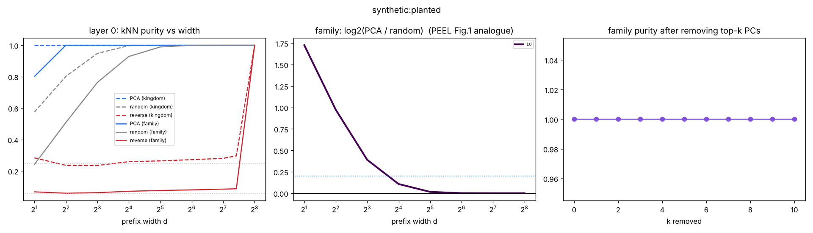
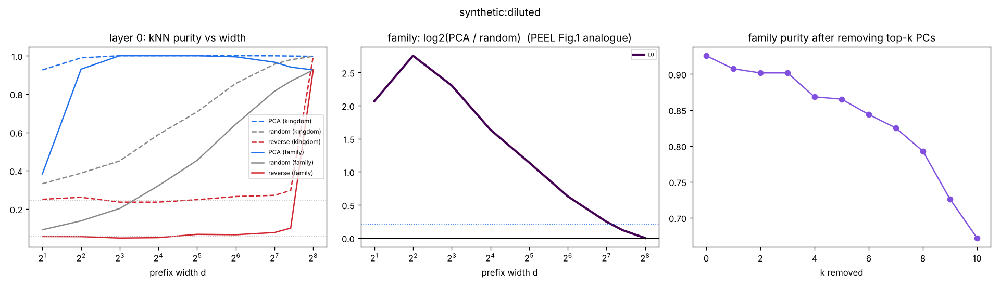
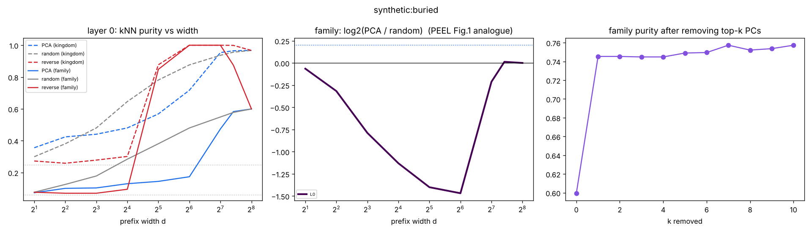

# Maatuska — report

Generated by `maatuska.py`; rules from `PREREGISTRATION.md`.

## Instrument check: PASSED

Each gate must be seen both passing and failing in worlds built to make it so.

- synthetic:planted: (K1, K2, K3) = (True, False, False), expected (True, False, False)
- synthetic:diluted: (K1, K2, K3) = (True, False, True), expected (True, False, True)
- synthetic:buried: (K1, K2, K3) = (False, True, False), expected (False, True, False)

### synthetic:planted  (primary layer 0 of 0)

- **K1 hidden Matryoshka: PASS** — best d=8: PCA 1.000 vs random 0.763 (max seed 0.839), reverse 0.062, log2 = +0.39
- **K2 frequency on top: FALSE** — corr(PC1, log-freq) = +0.10; removing top 1–3 PCs changes family purity by +0.000 (does not help by the 0.02 rule)
- **K3 tail dilution: FAIL** — d=171: 1.000 vs full 1.000, diff +0.000, 95% CI [+0.000, +0.000]

| d | PCA | random mean | random max | reverse | log2 PCA/random | pass |
|---:|---:|---:|---:|---:|---:|:---:|
| 8 | 1.000 | 0.763 | 0.839 | 0.062 | +0.39 | ✓ |
| 16 | 1.000 | 0.928 | 0.960 | 0.071 | +0.11 | ✗ |
| 32 | 1.000 | 0.989 | 0.996 | 0.077 | +0.02 | ✗ |
| 64 | 1.000 | 0.999 | 1.000 | 0.080 | +0.00 | ✗ |

### synthetic:diluted  (primary layer 0 of 0)

- **K1 hidden Matryoshka: PASS** — best d=8: PCA 1.000 vs random 0.203 (max seed 0.227), reverse 0.048, log2 = +2.30
- **K2 frequency on top: FALSE** — corr(PC1, log-freq) = -0.11; removing top 1–3 PCs changes family purity by -0.018 (does not help by the 0.02 rule)
- **K3 tail dilution: PASS** — d=171: 0.941 vs full 0.926, diff +0.015, 95% CI [+0.007, +0.023]

| d | PCA | random mean | random max | reverse | log2 PCA/random | pass |
|---:|---:|---:|---:|---:|---:|:---:|
| 8 | 1.000 | 0.203 | 0.227 | 0.048 | +2.30 | ✓ |
| 16 | 1.000 | 0.322 | 0.370 | 0.051 | +1.64 | ✓ |
| 32 | 1.000 | 0.454 | 0.469 | 0.068 | +1.14 | ✓ |
| 64 | 0.994 | 0.643 | 0.676 | 0.066 | +0.63 | ✓ |

### synthetic:buried  (primary layer 0 of 0)

- **K1 hidden Matryoshka: FAIL** — best d=8: PCA 0.103 vs random 0.178 (max seed 0.223), reverse 0.070, log2 = -0.79
- **K2 frequency on top: TRUE** — corr(PC1, log-freq) = -1.00; removing top 1–3 PCs changes family purity by +0.146 (helps by the 0.02 rule)
- **K3 tail dilution: FAIL** — d=171: 0.583 vs full 0.599, diff -0.017, 95% CI [-0.022, -0.011]

| d | PCA | random mean | random max | reverse | log2 PCA/random | pass |
|---:|---:|---:|---:|---:|---:|:---:|
| 8 | 0.103 | 0.178 | 0.223 | 0.070 | -0.79 | ✗ |
| 16 | 0.130 | 0.284 | 0.323 | 0.095 | -1.13 | ✗ |
| 32 | 0.144 | 0.381 | 0.396 | 0.848 | -1.40 | ✗ |
| 64 | 0.173 | 0.480 | 0.502 | 1.000 | -1.47 | ✗ |

