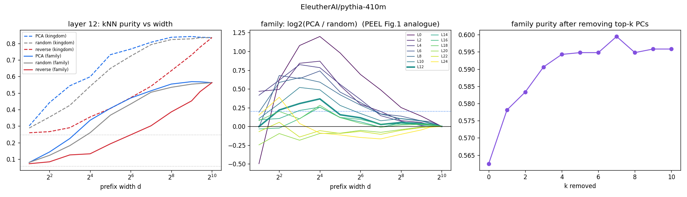
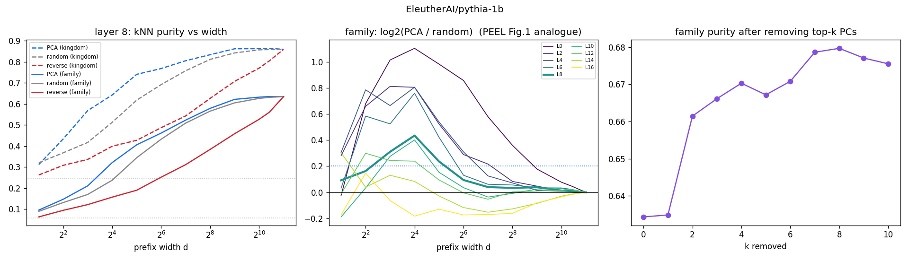

# Maatuska — report

Generated by `maatuska.py`; rules from `PREREGISTRATION.md`.

## Main claim (K1 on both primary models): PASS

### EleutherAI/pythia-410m  (primary layer 12 of 24)

- **K1 hidden Matryoshka: PASS** — best d=16: PCA 0.335 vs random 0.260 (max seed 0.315), reverse 0.133, log2 = +0.37
- **K2 frequency on top: FALSE** — corr(PC1, log-freq) = +0.44; removing top 1–3 PCs changes family purity by +0.028 (helps by the 0.02 rule)
- **K3 tail dilution: FAIL** — d=683: 0.568 vs full 0.562, diff +0.005, 95% CI [-0.002, +0.012]

| d | PCA | random mean | random max | reverse | log2 PCA/random | pass |
|---:|---:|---:|---:|---:|---:|:---:|
| 8 | 0.225 | 0.182 | 0.234 | 0.126 | +0.30 | ✗ |
| 16 | 0.335 | 0.260 | 0.315 | 0.133 | +0.37 | ✓ |
| 32 | 0.408 | 0.366 | 0.405 | 0.193 | +0.16 | ✗ |
| 64 | 0.470 | 0.434 | 0.450 | 0.247 | +0.11 | ✗ |

### EleutherAI/pythia-1b  (primary layer 8 of 16)

- **K1 hidden Matryoshka: PASS** — best d=16: PCA 0.321 vs random 0.238 (max seed 0.260), reverse 0.157, log2 = +0.43
- **K2 frequency on top: FALSE** — corr(PC1, log-freq) = +0.17; removing top 1–3 PCs changes family purity by +0.032 (helps by the 0.02 rule)
- **K3 tail dilution: FAIL** — d=1365: 0.635 vs full 0.634, diff +0.001, 95% CI [-0.005, +0.006]

| d | PCA | random mean | random max | reverse | log2 PCA/random | pass |
|---:|---:|---:|---:|---:|---:|:---:|
| 8 | 0.211 | 0.170 | 0.176 | 0.122 | +0.31 | ✓ |
| 16 | 0.321 | 0.238 | 0.260 | 0.157 | +0.43 | ✓ |
| 32 | 0.406 | 0.344 | 0.361 | 0.190 | +0.24 | ✓ |
| 64 | 0.461 | 0.432 | 0.452 | 0.252 | +0.09 | ✗ |

