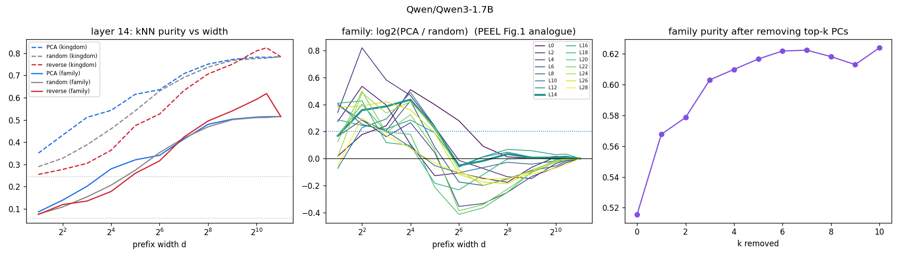

# Maatuska — report

Generated by `maatuska.py`; rules from `PREREGISTRATION.md`.

### Qwen/Qwen3-1.7B  (primary layer 14 of 28)

- **K1 hidden Matryoshka: PASS** — best d=16: PCA 0.280 vs random 0.207 (max seed 0.228), reverse 0.179, log2 = +0.44
- **K2 frequency on top: TRUE** — corr(PC1, log-freq) = +0.54; removing top 1–3 PCs changes family purity by +0.088 (helps by the 0.02 rule)
- **K3 tail dilution: FAIL** — d=1365: 0.515 vs full 0.516, diff -0.001, 95% CI [-0.005, +0.003]

| d | PCA | random mean | random max | reverse | log2 PCA/random | pass |
|---:|---:|---:|---:|---:|---:|:---:|
| 8 | 0.202 | 0.154 | 0.199 | 0.135 | +0.39 | ✓ |
| 16 | 0.280 | 0.207 | 0.228 | 0.179 | +0.44 | ✓ |
| 32 | 0.321 | 0.274 | 0.305 | 0.260 | +0.23 | ✓ |
| 64 | 0.341 | 0.354 | 0.371 | 0.316 | -0.05 | ✗ |

